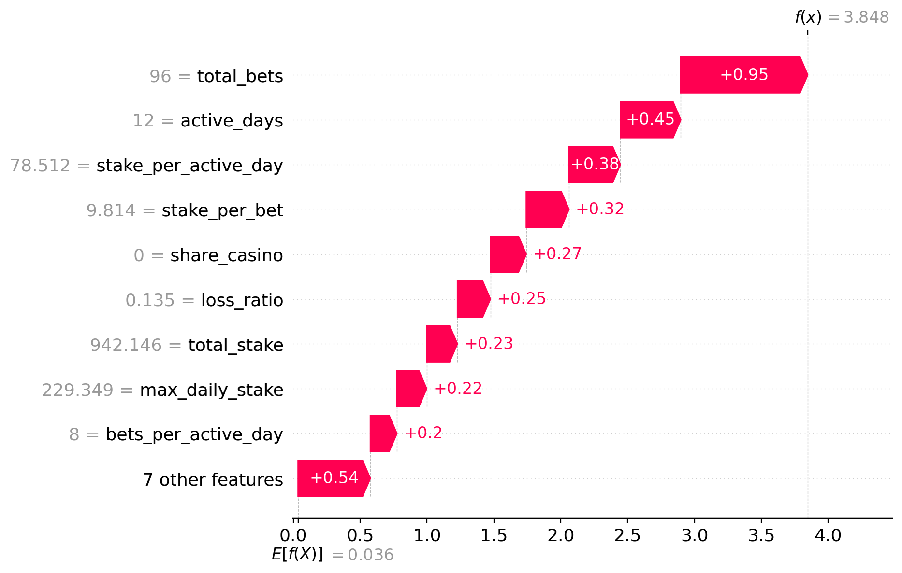
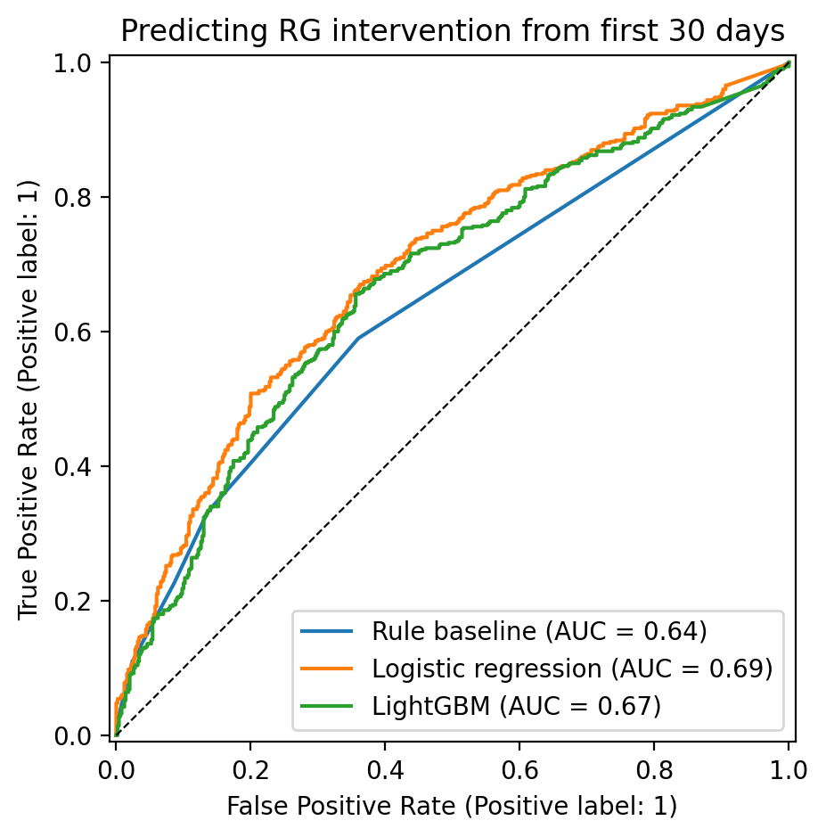
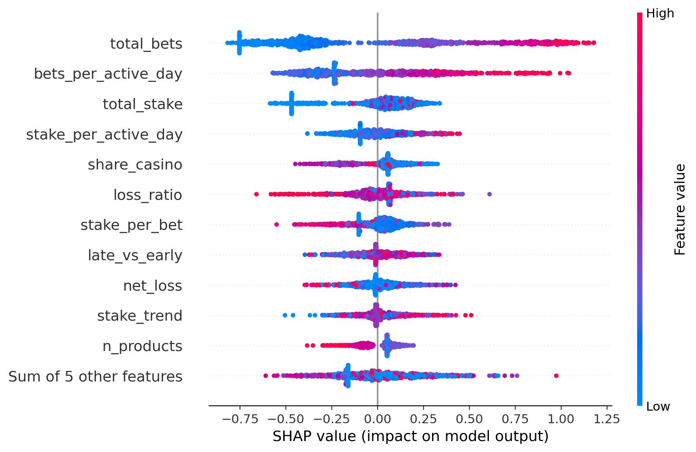

# Gambling Harm Early Detection

[](https://colab.research.google.com/github/chilukuru-saikrishna/gambling-harm-early-detection/blob/main/gambling_harm_early_detection_bwin.ipynb)

An explainable model that uses only a player's **first 30 days** of betting to predict whether they will later trigger a responsible gambling (RG) intervention, and shows **why** each player was flagged.

It compares three approaches on the same data:

1. A **rule-based points score**, like the threshold rules many operators use today
2. **Logistic regression**, simple and transparent
3. **LightGBM**, gradient boosting that can capture non-linear patterns

Each flag is explained with **SHAP**, so an RG analyst can see which behaviours drove the score before deciding whether to act.

> **Status:** the full pipeline runs end to end on a simulated stand-in dataset. It is built to run unchanged on the real bwin cohort from the Harvard Division on Addiction's Transparency Project (see [Data](#data)); results on that data will be added here.

## Key finding so far

The single highest-scored player in the test set was **not** a harmed player. They were flagged for sheer volume: 96 bets over 12 active days. This is the core weakness of behaviour-based detection, because a heavy but healthy recreational player can look like a harmed one. SHAP makes that visible, which is why explainability matters as much as accuracy in this domain.



## Results (simulated data: pipeline validation only)

| Model | AUC | Precision (top 20% flagged) | Recall (top 20% flagged) |
|---|---|---|---|
| Rule-based baseline | 0.644 | 0.725 | 0.290 |
| Logistic regression | 0.693 | 0.740 | 0.296 |
| LightGBM | 0.669 | 0.690 | 0.276 |

"Top 20% flagged" mirrors a real RG team, which can only review a limited share of players. These numbers only show that the pipeline works; they say nothing about real player behaviour.



## How it works

| Step | What happens |
|---|---|
| Early window | Keeps only each player's first 30 days after first deposit, so the model detects risk early and nothing after the intervention leaks in |
| Features | 16 behavioural markers from the research literature: frequency, wager volume, peak daily stake, erratic staking, losses, escalation over time, and cross-game play (sports, casino, poker) |
| Baseline | Points-based rule score: one point per marker above the 75th percentile |
| Models | Logistic regression and LightGBM, 5-fold cross-validation, held-out test set |
| Explanation | SHAP beeswarm (what drives risk overall) and waterfall (why one player was flagged) |
| Scoring | `score_player()` returns a score, risk band and reasons for any player; a Gradio demo makes it interactive |



## Use the model

The notebook ends with two ways to use the trained model:

- **`score_player()`** (Cell 12) takes one player's 30-day features and returns a risk score, a risk band (LOW / MEDIUM / HIGH), and the behaviours that raised or lowered their risk. The trained model is saved as `harm_model.joblib` for reuse.
- **Interactive demo** (Cell 13): a Gradio app with sliders for activity, stakes, losses, escalation and product mix. Move them, click **Score player**, and see the score and a chart of what drove it. In Colab it opens inline and also gives a temporary public link.

In practice, a model like this would sit **alongside** existing rule-based monitoring as a triage layer: score new players daily, have analysts review the highest-risk players with their SHAP reasons, and keep a human in charge of every decision. Real use would need retraining on the operator's own data, recalibrated thresholds, a DPIA, and ongoing monitoring for drift and bias.

## Data

The notebook is designed for **Cohort 3** of the bwin.party / Division on Addiction datasets: the full betting history of about 4,100 players, half of whom triggered an RG intervention between November 2008 and November 2009, plus matched controls who first deposited on the same day.

The data is **not included** in this repository. It is available from the Transparency Project (thetransparencyproject.org) under its own terms of use. To run on it, download the files, then set `USE_REAL_DATA = True` and match the column names to the codebook in Cell 2.

Without the real data, the notebook generates a **simulated stand-in** with the same structure, so every cell runs.

**Reference:** Braverman, J., LaPlante, D. A., Nelson, S. E., & Shaffer, H. J. (2013). Using cross-game behavioral markers for early identification of high-risk Internet gamblers. *Psychology of Addictive Behaviors.*

## Limitations

- The bwin data dates from 2005–2009, and products and behaviour have changed since.
- The label is "triggered an operator RG intervention", which reflects one operator's rules, not a clinical diagnosis.
- Cases and controls are balanced 50/50; in a live player base harm is far rarer, so precision would be lower.
- The data is daily aggregates, so time-of-day markers such as night play aren't available.
- This is a proof of method, not a deployable model.

## Run it

Click **Open in Colab** above and choose **Runtime → Run all**. To run locally:

```bash
pip install -r requirements.txt
jupyter notebook gambling_harm_early_detection_bwin.ipynb
```

## Stack

Python · pandas · NumPy · scikit-learn · LightGBM · SHAP · Gradio · matplotlib · Google Colab

## License

MIT
